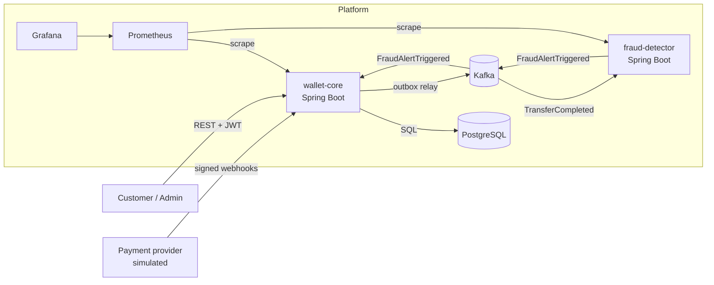
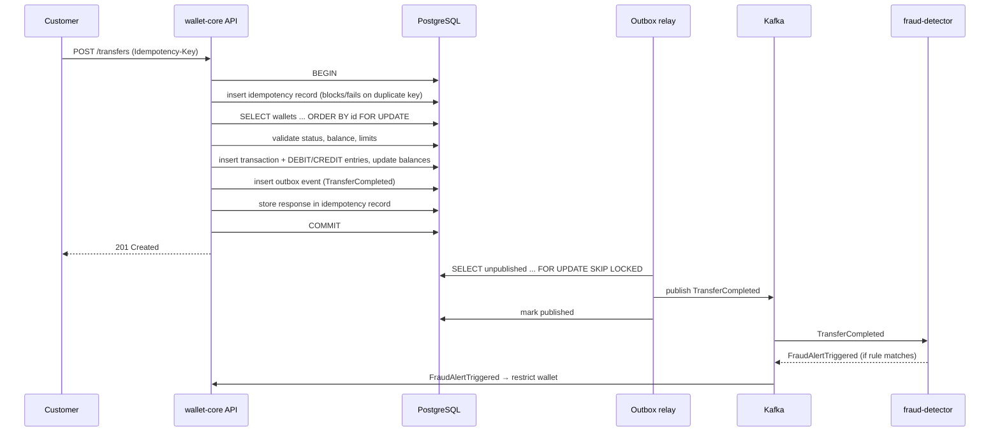

# 2. Architecture

## Overview



Two independently deployable services that share no code and no database. They communicate **only
through Kafka events** with a documented JSON contract ([ADR-0002](adr/0002-services-communicate-only-through-kafka.md)).
Either service can be replaced by an implementation in another language without touching the other.

| Component | Responsibility |
|---|---|
| **wallet-core** | Users, authentication, wallets, ledger, cash-in, transfers, cash-out, limits, idempotency, outbox. The only owner of money. |
| **fraud-detector** | Consumer of transfer events; applies real-time rules over in-memory sliding windows and emits fraud alerts. Has no database and never calls wallet-core. |
| **PostgreSQL** | Source of truth for wallet-core: ledger, balances, idempotency records, outbox. |
| **Kafka** | Domain event transport. |
| **Prometheus + Grafana** | Metrics and dashboard. |

## Technology

Java 25, Spring Boot 4, Maven, PostgreSQL, Flyway, Apache Kafka, JUnit 5 + Testcontainers, Micrometer +
Prometheus + Grafana, springdoc-openapi, Docker Compose ([ADR-0001](adr/0001-technology-stack.md)).

Virtual threads are enabled for request handling. Database concurrency is bounded by the connection
pool, not by threads.

## Repository layout

```
mypocket/
├── pom.xml                      # build aggregator only (no shared code)
├── services/
│   ├── wallet-core/
│   └── fraud-detector/
├── infra/
│   ├── prometheus/
│   └── grafana/
├── scripts/                     # payment provider simulator (signed webhooks)
├── docs/
│   └── adr/
└── compose.yaml
```

## wallet-core internal structure

A modular monolith organized **by feature**, each with the same small set of layers:

```
com.amillioncodelines.mypocket.wallet
├── user/        # registration, login, roles; the only place with personal data
├── wallet/      # wallets and lifecycle
├── ledger/      # transactions, entries, balance updates, history
├── cashin/
├── transfer/
├── cashout/     # withdrawals, limits, provider confirmation
├── idempotency/
├── events/      # outbox, relay, Kafka consumer of fraud alerts
└── shared/      # money, errors, security config, clock
```

- `api` — controllers and request/response records. No business logic.
- `application` — use cases; each one is a single database transaction.
- `domain` — entities with behavior and the business rules ([Domain model](03-domain-model.md)).
- `infrastructure` — repositories, Kafka, webhook signature verification.

Features call each other only through application services, never through another feature's
repositories. Only the `ledger` feature writes ledger entries and balances.

## Money movement flow (P2P transfer)



## Key architectural decisions

| ADR | Decision |
|---|---|
| [0001](adr/0001-technology-stack.md) | Technology stack |
| [0002](adr/0002-services-communicate-only-through-kafka.md) | Two services in a monorepo, communicating only through Kafka |
| [0003](adr/0003-double-entry-ledger.md) | Double-entry ledger with cached balance on customer wallets |
| [0004](adr/0004-pessimistic-locking-in-deterministic-order.md) | Pessimistic locking in deterministic order |
| [0005](adr/0005-idempotency-in-postgresql.md) | Idempotency stored in PostgreSQL inside the business transaction |
| [0006](adr/0006-transactional-outbox.md) | Transactional outbox with a polling relay |
| [0007](adr/0007-self-issued-jwt.md) | Self-issued JWT for authentication |
| [0008](adr/0008-signed-provider-webhooks.md) | HMAC-signed webhooks from the payment provider |
| [0009](adr/0009-money-representation.md) | Money representation |
| [0010](adr/0010-platform-generated-identifiers.md) | Platform-generated identifiers instead of personal data |
