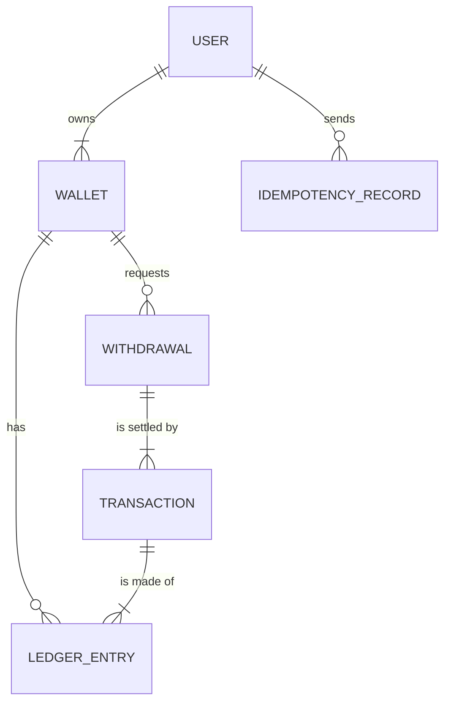

# 3. Domain Model and Business Rules

Every rule has an ID (for example `T3`). Tests reference these IDs in their display name so each rule
can be traced to the tests that verify it.

## Glossary

| Term | Meaning |
|---|---|
| **User** | A person who logs in: a customer or an administrator. Identified by a platform-generated user id. |
| **Wallet** | Where a customer holds money in one currency, with its balance and status. Each customer has one wallet per currency. MyPocket as a whole is a digital wallet product; in these documents "wallet" always means this per-currency wallet. |
| **Account number** | The public 10-digit number of a wallet, used to receive cash-ins and transfers. It names a wallet; it is not a separate concept. |
| **System wallet** | A platform wallet with no owner and no account number, the counterpart of money entering, leaving or in transit (`EXTERNAL`, `WITHDRAWALS_IN_TRANSIT`). |
| **Transaction** | One money movement in the ledger (cash-in, transfer, withdrawal and its settlement or reversal). |
| **Entry** | One side of a transaction on one wallet: a debit or a credit. |
| **External account** | An account at another institution, outside the platform: the destination of a withdrawal. |
| **Provider reference** | The payment provider's identifier of a cash-in or a payout. |
| **Rejected operation** | A money operation that a business rule rejected, recorded for audit. It moves no money. |

## Entities

| Entity | Main attributes |
|---|---|
| **User** | id, email (unique, case-insensitive), password hash, role (`CUSTOMER`, `ADMIN`), created at |
| **Wallet** | id, account number (customer wallets), owner (user, or none for system wallets), kind (`CUSTOMER`, `SYSTEM`), system purpose, currency, status, status reason, balance, created at |
| **Transaction** | id, type (`CASH_IN`, `TRANSFER`, `WITHDRAWAL`, `WITHDRAWAL_SETTLEMENT`, `WITHDRAWAL_REVERSAL`), currency, amount, external reference, description (transfers), created at |
| **LedgerEntry** | id, transaction, wallet, direction (`DEBIT`, `CREDIT`), amount, created at |
| **Withdrawal** | id, wallet, amount, destination (free-text external account), status (`PENDING`, `COMPLETED`, `FAILED`), provider reference, created at, settled at |
| **IdempotencyRecord** | user, key, request fingerprint, response status, response body, created at |
| **RejectedOperation** | id, type (`CASH_IN`, `TRANSFER`, `WITHDRAWAL`), reason (the error code), user (customer operations), provider reference (cash-ins), source wallet, destination account number, currency, amount, created at |
| **OutboxEvent** | id, type, aggregate key, payload (JSON), created at, published at |

### System wallets

Double-entry bookkeeping needs a counterpart for money that enters or leaves the platform. Per currency
there are two system wallets, created by migration:

| Purpose | Used for |
|---|---|
| `EXTERNAL` | Counterpart of cash-ins (money comes from outside) and of completed withdrawals (money goes outside). Its ledger balance is negative: it represents what the platform owes customers. |
| `WITHDRAWALS_IN_TRANSIT` | Holds money of pending withdrawals until the provider confirms or rejects them. |

### Movements in the ledger

| Operation | DEBIT | CREDIT |
|---|---|---|
| Cash-in | `EXTERNAL` | customer wallet |
| Transfer | sender wallet | recipient wallet |
| Withdrawal requested | customer wallet | `WITHDRAWALS_IN_TRANSIT` |
| Withdrawal completed | `WITHDRAWALS_IN_TRANSIT` | `EXTERNAL` |
| Withdrawal failed | `WITHDRAWALS_IN_TRANSIT` | customer wallet |

The balance of a wallet is `sum(CREDIT) − sum(DEBIT)` of its entries.

## Business rules

### Money (M)
- **M1** Amounts are decimal with at most 2 fractional digits and at most 13 integer digits, for both ARS and USD. Amounts with more digits are rejected, never rounded.
- **M2** Every operation amount is strictly greater than zero.
- **M3** Supported currencies are ARS and USD. Any other currency is rejected.
- **M4** Money only moves between wallets of the same currency.

### Users (U)
- **U1** Email is required, must be a valid address of at most 254 characters, and is unique ignoring case. It is used only to log in (P1).
- **U2** Password is not blank and has between 8 and 64 characters, and at most 72 bytes in UTF-8 (the limit of the hashing algorithm; longer passwords are rejected, never truncated). It is stored only as a hash.
- **U3** Registering creates the user with role `CUSTOMER` and one `ACTIVE` wallet per supported currency, with zero balance, in the same transaction.
- **U4** Login with a wrong email or a wrong password gives the same error, so it does not reveal whether the email exists.
- **U5** The administrator user is created at startup from configuration if it does not exist. Registration never creates administrators.

### Personal data (P)
- **P1** Personal data (email, password hash) is stored only in the user module. It never appears in other tables, events, logs, or in responses about other customers.
- **P2** Customers, wallets, transfers and events refer to people only through platform-generated identifiers (user id, wallet id, account number).

### Wallets (W)
- **W1** A customer has exactly one wallet per currency.
- **W2** A new wallet is `ACTIVE` and gets a unique **account number**: 10 digits, the last one a Luhn check digit, generated randomly by the platform and never reused.
- **W3** Status rules for money movement:

  | Status | Receive (cash-in, incoming transfer) | Send (outgoing transfer, withdrawal request) |
  |---|---|---|
  | `ACTIVE` | yes | yes |
  | `DEBIT_BLOCKED` | yes | no |
  | `FROZEN` | no | no |
  | `CLOSED` | no | no |

- **W4** Withdrawals already `PENDING` are still settled (completed or reversed) whatever the wallet status, except that a `CLOSED` wallet never has pending withdrawals (W8).
- **W5** An administrator can move a wallet between `ACTIVE`, `DEBIT_BLOCKED` and `FROZEN` in any direction, giving a reason. Setting the status the wallet already has is not an error and changes nothing.
- **W6** The fraud detector can restrict a wallet through a fraud alert that asks for `DEBIT_BLOCKED` or `FROZEN`. An alert only makes a wallet more restrictive (`ACTIVE` < `DEBIT_BLOCKED` < `FROZEN`); it never relaxes it and has no effect on a closed wallet.
- **W7** Only an administrator can lift or relax a restriction.
- **W8** A customer can close their own wallet only if it is `ACTIVE`, its balance is zero and it has no `PENDING` withdrawals.
- **W9** `CLOSED` is final: a closed wallet cannot change status again. Its account number is not reassigned.
- **W10** A customer can only see and operate wallets they own. Access to another customer's wallet answers as if it did not exist.

### Ledger (L)
- **L1** Every money movement is one transaction with at least two entries, and the total of its debits equals the total of its credits.
- **L2** Ledger entries and transactions are never updated or deleted, not even directly in the database. Corrections are new transactions.
- **L3** The cached balance of a customer wallet always equals the balance computed from its entries.
- **L4** The balance of a customer wallet is never negative.
- **L5** System wallets have no cached balance; their balance is always computed from their entries.
- **L6** A wallet's history lists its entries from newest to oldest, paginated, with the transaction type and, for transfers, the counterpart's account number.
- **L7** An operation that cannot lock its wallets within 5 seconds is rejected as temporarily unavailable and changes nothing, so the client can retry it.

### Idempotency (I)
- **I1** Transfer and withdrawal requests require an `Idempotency-Key` header (1 to 100 visible ASCII characters). A missing or invalid key is rejected.
- **I2** Keys are scoped per user: two users may use the same key independently.
- **I3** Repeating a request with the same key and the same body returns the original response (status and body) and moves no money.
- **I4** Reusing a key with a different body or for a different operation is rejected. Bodies are compared by their parsed values, so formatting or field order does not make them different.
- **I5** Two concurrent requests with the same key result in a single operation; the other one receives the original response.
- **I6** Only successful responses are stored. A request rejected by a business rule (for example insufficient funds) can be retried with the same key and is evaluated again.
- **I7** Idempotency records do not expire.

### Cash-in (CI)
- **CI1** A cash-in arrives only through a provider webhook with a valid signature (see S5), and names the destination wallet by its account number. An unknown account number is rejected.
- **CI2** A cash-in is identified by the provider's reference (1 to 100 letters, digits or `.`, `_`, `:`, `-`). The same reference is applied only once; repeating it, even concurrently, returns the original result.
- **CI3** The same provider reference with different data (account number, amount or currency) is rejected.
- **CI4** The currency of the cash-in must match the wallet's currency.
- **CI5** A cash-in to a wallet that cannot receive money (W3) is rejected, and the provider keeps the money. A rejected cash-in is not applied and does not reserve its reference: if the provider retries it, it is evaluated again.
- **CI6** Cash-ins have no business amount limit; only the format limits of M1 apply.
- **CI7** Every cash-in with a valid signature that a business rule rejects (unknown account, reference conflict, currency mismatch, wallet that cannot receive) is logged with the provider reference, the account number and the reason, and counted in the `mypocket.cashin.rejected` metric by reason. Requests with an invalid signature are logged without their content, since it cannot be trusted (S5).

### Transfers (T)
- **T1** The sender chooses one of their wallets and the destination wallet's account number. An unknown account number is rejected.
- **T2** Source and destination must be different wallets, and of the same currency (M4). Transfers between two wallets of the same customer are therefore impossible (W1).
- **T3** The source wallet must be able to send and the destination wallet must be able to receive (W3). A wallet that cannot send is rejected before anything about the destination is checked.
- **T4** The sender's balance must cover the amount.
- **T5** The amount cannot exceed the per-operation limit of the currency.
- **T6** A transfer is atomic: both balances change together or neither changes.
- **T7** Concurrent transfers, including opposite transfers between the same two wallets, never deadlock and never lose or create money.
- **T8** A transfer has an optional description of up to 140 characters, without control, formatting (such as text direction overrides) or line separator characters. Both sides see it; it is never logged or recorded with rejected operations.

### Cash-out (CO)
- **CO1** The customer chooses one of their wallets, an amount and a destination (an external account identifier, 1 to 100 characters).
- **CO2** The wallet must be able to send (W3) and its balance must cover the amount.
- **CO3** The amount cannot exceed the per-operation limit of the currency.
- **CO4** The total of the wallet's `PENDING` and `COMPLETED` withdrawals in the current calendar day, plus the new amount, cannot exceed the daily limit of the currency. The day is measured in the platform time zone (`America/Argentina/Buenos_Aires` by default).
- **CO5** Requesting a withdrawal moves the money to `WITHDRAWALS_IN_TRANSIT` immediately and leaves the withdrawal `PENDING`.
- **CO6** The provider settles a withdrawal through a signed webhook with the outcome `COMPLETED` or `FAILED`.
- **CO7** `COMPLETED` moves the money from `WITHDRAWALS_IN_TRANSIT` to `EXTERNAL`. `FAILED` returns it to the customer wallet.
- **CO8** Only `PENDING` withdrawals can be settled. Repeating the same outcome is accepted with no effect; a different outcome for a settled withdrawal is rejected.
- **CO9** Settlement is applied whatever the wallet status (W4).

### Fraud (F)
- **F1** The fraud detector raises an alert asking for `DEBIT_BLOCKED` when a wallet sends more than N transfers within any 60-second window (N configurable, default 10).
- **F2** Only one alert is raised per wallet per window.
- **F3** Processing the same transfer event twice does not count it twice.
- **F4** The detector keeps its windows in memory. After a restart the windows start empty.

### Events (E)
- **E1** Each completed transfer emits a `TransferCompleted` event, written in the same transaction as the transfer.
- **E2** Events are published at least once. Consumers deduplicate by event id.
- **E3** Events of the same wallet are published in the order they were committed.
- **E4** Each fraud alert emits a `FraudAlertTriggered` event, with the requested status, that wallet-core consumes to restrict the wallet (W6).

### Rejected operations (R)
- **R1** Every money operation rejected by a business rule (cash-ins with a valid signature, and customer transfers and withdrawals) is recorded with its type, the identifiers it named, the amount, the currency, the reason and the time. The record is kept even though the operation rolls back; if it cannot be written, the failure is logged and the caller still receives the original rejection.
- **R2** Rejected operations move no money, are not part of the ledger, and are never updated or deleted.
- **R3** Requests rejected before reaching the business rules (invalid signature, malformed or invalid body, missing authentication or idempotency key) are not recorded. Transfer descriptions are never recorded.

## Configuration defaults

| Setting | ARS | USD |
|---|---|---|
| Per-operation limit (transfers and withdrawals) | 1,000,000.00 | 5,000.00 |
| Daily withdrawal limit per wallet | 2,000,000.00 | 10,000.00 |

| Setting | Default |
|---|---|
| Platform time zone | `America/Argentina/Buenos_Aires` |
| Fraud rule: max transfers per 60 s | 10 |
